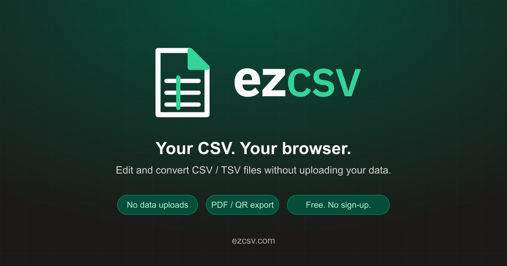

# ブランド素材ガイド（ロゴ・favicon・OGP）

提供されたSVGロゴは [`public/brand`](../public/brand) に格納しています。

| 用途                | 素材・生成先                                                                     |
| ------------------- | -------------------------------------------------------------------------------- |
| アプリ内のロゴ      | `public/brand/ezcsv-lockup-light.svg`（共通の `BrandLogo` コンポーネント）       |
| README              | 明るい背景／暗い背景用の横組みロゴを自動切り替え                                 |
| favicon             | `src/app/icon.svg`、`src/app/favicon.ico`（16／32／48px）                        |
| Appleホーム画面     | `src/app/apple-icon.png`（180px）                                                |
| Webアプリ用アイコン | `public/icons/icon-192.png`、`public/icons/icon-512.png`、`public/manifest.json` |
| OGP・Xのカード      | `src/app/opengraph-image.png`（1200×630px）                                      |

## 再生成手順

元のSVGを差し替えたら、次のコマンドで画像を再生成し、生成物もコミットしてください。ブランド画像の生成・配信には外部サービスへのアクセスは不要です。

```bash
corepack pnpm run assets:generate
```

OGPプレビュー:


